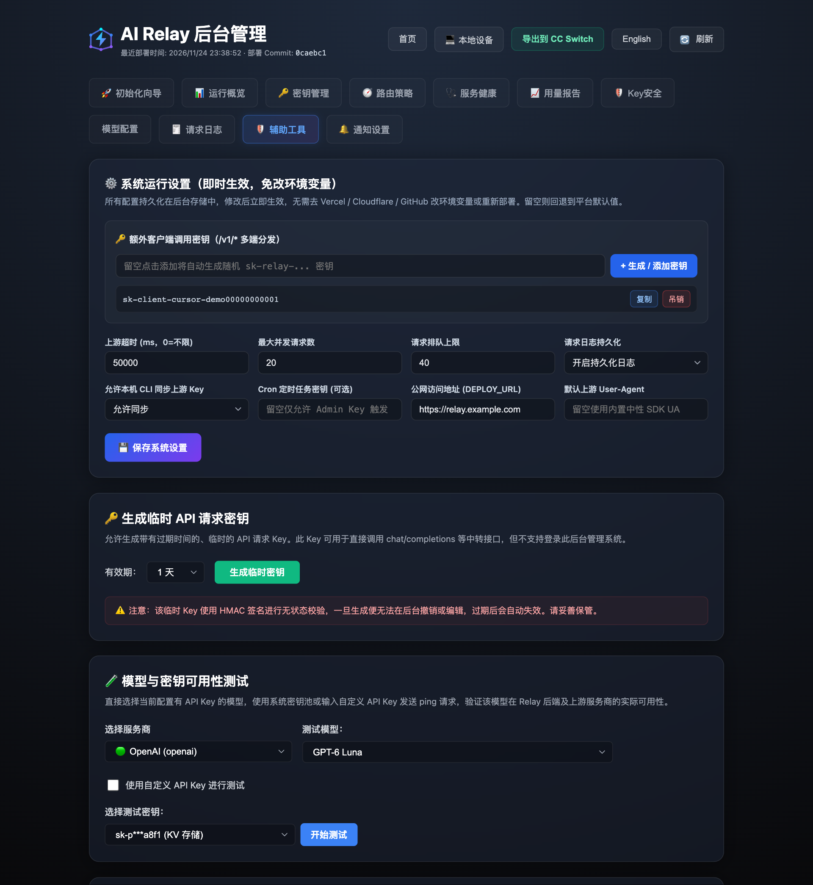

<div align="center">


**Lightweight personal AI API gateway — one endpoint for all your LLM providers**

[](CHANGELOG.md)
[](LICENSE)

**English** · [中文](README_CN.md)

</div>

---

## 🚀 Quick Deploy

Expand only the deployment option you want:

<details>
<summary><strong>⚡ Cloudflare Workers (Recommended · Easiest & Free)</strong></summary>

[](https://deploy.workers.cloudflare.com/?url=https://github.com/MoyuFamily/ai-relay)

1. Click the button above and authorize GitHub
2. KV and D1 are auto-provisioned — simply click **Deploy**
3. Open `/admin`, copy & lock your auto-generated access key, then add your upstream provider keys

**🎬 32s deploy walkthrough**

https://github.com/user-attachments/assets/d0db21cb-8967-4a10-aeb8-033f75e054f6

**🤖 Or let your AI Agent deploy it** (paste into Claude Code / Codex / Cursor):

```text
Clone https://github.com/MoyuFamily/ai-relay, follow the Cloudflare Workers workflow in docs/AGENT-OPS.md to deploy it, run the post-deploy smoke tests, and return my /admin URL.
```

</details>

<details>
<summary><strong>☁️ Vercel (Free · Upstash Redis)</strong></summary>

[](https://vercel.com/new/clone?repository-url=https://github.com/MoyuFamily/ai-relay&stores=%5B%7B%22type%22%3A%22integration%22%2C%22integrationSlug%22%3A%22upstash%22%2C%22productSlug%22%3A%22upstash-kv%22%2C%22protocol%22%3A%22storage%22%7D%5D)

1. Click the button above, choose GitHub, and click **Create**
2. Click **Add Upstash for Redis** → pick a Region → select **Free** → **Continue → Create → Done**
3. Open `/admin`, copy & lock your auto-generated access key, then add your upstream provider keys

**🎬 42s deploy walkthrough**

https://github.com/user-attachments/assets/79ef3985-6ffa-4edc-aded-41b6e4db3bb3

**🤖 Or let your AI Agent deploy it** (paste into Claude Code / Codex / Cursor):

```text
Clone https://github.com/MoyuFamily/ai-relay, follow the Vercel workflow in docs/AGENT-OPS.md to deploy it with free Upstash Redis, run the post-deploy smoke tests, and return my /admin URL and access key.
```

</details>

<details>
<summary><strong>🐳 Self-Host with Docker (VPS / NAS · No Serverless Timeouts)</strong></summary>

```bash
# Single-container quick start (persists to Docker volume, zero external DB needed)
docker run -d --name ai-relay --restart unless-stopped \
  -p 3000:3000 \
  -v ai-relay-data:/app/data \
  ghcr.io/moyufamily/ai-relay:latest
```

To use PostgreSQL storage instead, clone the repo and run `bash scripts/quick-start.sh --postgres`. Then open `http://your-host:3000/admin` to finish first-time setup.

**🤖 Or let your AI Agent deploy it**:

```text
Deploy https://github.com/MoyuFamily/ai-relay on this server using Docker per docs/AGENT-OPS.md, mount persistent storage, verify /health?liveness=1, and return the /admin URL.
```

</details>

<details>
<summary><strong>💻 Run Locally (<code>airelay</code> CLI · Direct Local Gateway for Claude Code / Codex)</strong></summary>

```bash
git clone https://github.com/MoyuFamily/ai-relay.git && cd ai-relay
pnpm install && pnpm link --global
airelay login https://your-relay.example.com && airelay local:start
```

See [CLI_GUIDE.md](CLI_GUIDE.md) for standalone JSON config and automatic Codex / Claude Code setup.

**🤖 Or let your AI Agent set it up**:

```text
Clone https://github.com/MoyuFamily/ai-relay, install and start the local airelay gateway following CLI_GUIDE.md and docs/AGENT-OPS.md, and verify Claude Code / Codex integration with agent:doctor.
```

</details>

---

## 🔌 Connect Any Client

**OpenAI SDK / curl / Cursor / Cherry Studio**

```bash
curl -X POST https://your-domain/v1/chat/completions \
  -H "Authorization: Bearer YOUR_ACCESS_KEY" \
  -H "Content-Type: application/json" \
  -d '{"model":"gpt-6-luna","messages":[{"role":"user","content":"Hello!"}]}'
```

**Claude Code / Anthropic SDK**

```bash
export ANTHROPIC_BASE_URL="https://your-domain"
export ANTHROPIC_API_KEY="YOUR_ACCESS_KEY"
claude
```

---

## ✨ Highlights

- **One Endpoint for Every Model**: Built-in OpenAI, Anthropic (Claude), Google Gemini, DeepSeek, OpenRouter, and any OpenAI/Anthropic-compatible upstream — with transparent bidirectional OpenAI ↔ Anthropic translation.
- **Built for Reliability**: Multi-key round-robin rotation, automatic 429/5xx cooldowns, cycle-safe cross-provider fallback chains, circuit breaking, and smart routing.
- **Full Visual Admin Console**: Manage provider key pools, extra client keys, model aliases, live relay testing, usage analytics, Slack/Feishu/WeCom/DingTalk webhooks, and 1-click backup/migration.

<div align="center">

</div>

<details>
<summary>More Admin screenshots</summary>




</details>

---

## 📚 Documentation

- **[Agent Deployment & Maintenance Runbook](docs/AGENT-OPS.md)** ([AGENTS.md](AGENTS.md))
- **[CLI & Local Relay Guide](CLI_GUIDE.md)**
- **[Technical Design](docs/TECH-DESIGN.md)** · **[Storage Architecture](docs/storage-architecture.md)**
- **[FAQ](docs/FAQ.md)** · **[Release Flow](docs/RELEASE-FLOW.md)** · **[Changelog](CHANGELOG.md)**

---

**Infrastructure Sponsor**: [Hosted on CubePath](https://cubepath.com/?utm_source=open-source&utm_medium=referral&utm_campaign=hosted-on-cubepath) · **License**: [MIT](LICENSE)
