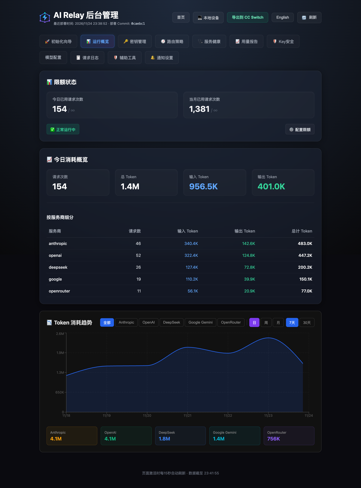
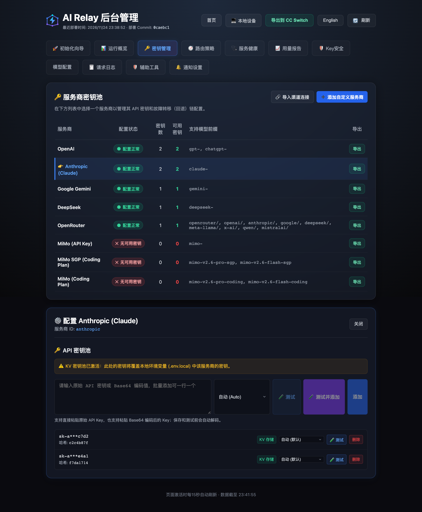
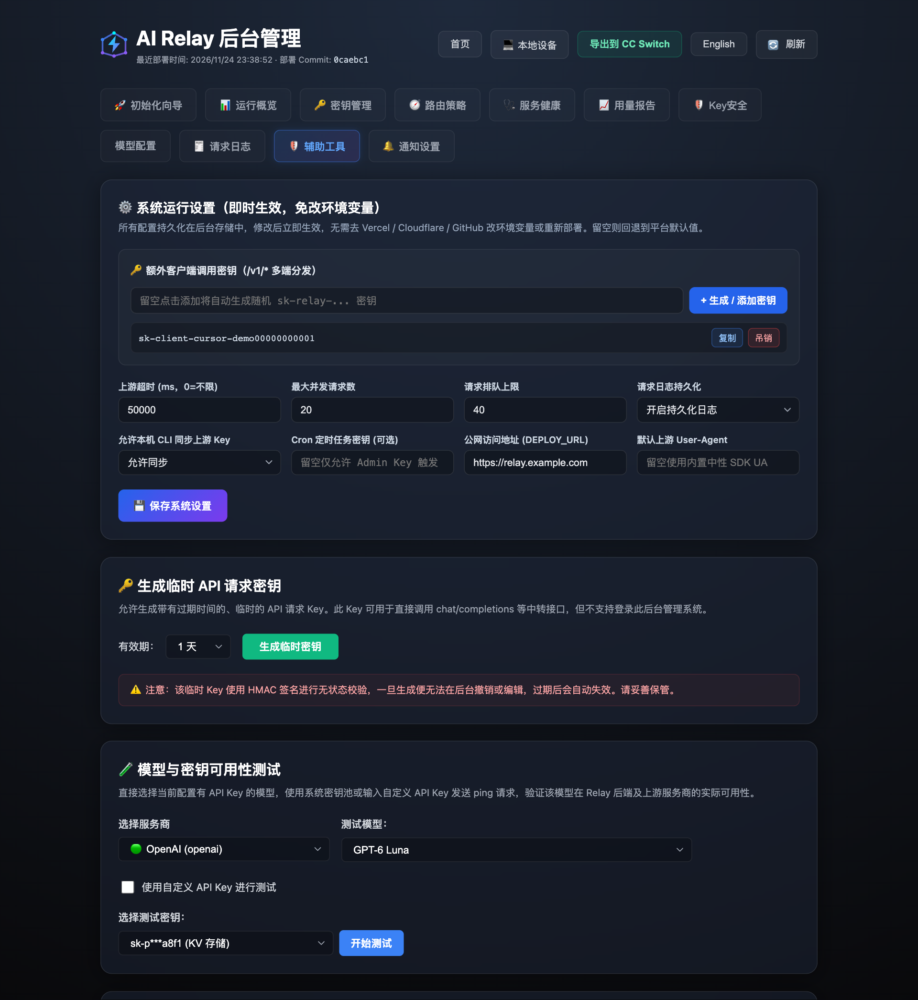

<div align="center">


**个人与团队的 AI API 统一网关 — 一个端点，统一路由所有大模型**

[](CHANGELOG.md)
[](LICENSE)

[English](README.md) · **中文**

</div>

---

## 🚀 快速部署

点开你准备使用的那一种即可：

<details>
<summary><strong>⚡ Cloudflare Workers（推荐 · 免费最省事）</strong></summary>

[](https://deploy.workers.cloudflare.com/?url=https://github.com/MoyuFamily/ai-relay)

1. 点击上方按钮，连接并授权 GitHub
2. KV 与 D1 自动新建并绑定，直接点击 **Deploy**
3. 上线后打开 `/admin`，复制自动生成的随机密钥并点击锁定，添加上游 API Key 即可使用

**🎬 32 秒部署演示**

https://github.com/user-attachments/assets/d0db21cb-8967-4a10-aeb8-033f75e054f6

**🤖 或直接交给 AI Agent 部署**（复制到 Claude Code / Codex / Cursor）：

```text
克隆 https://github.com/MoyuFamily/ai-relay，按 docs/AGENT-OPS.md 的 Cloudflare 流程帮我部署到 Cloudflare Workers，完成后跑部署后自检，并把后台 /admin 地址返回给我。
```

</details>

<details>
<summary><strong>☁️ Vercel（免费 · Upstash Redis）</strong></summary>

[](https://vercel.com/new/clone?repository-url=https://github.com/MoyuFamily/ai-relay&stores=%5B%7B%22type%22%3A%22integration%22%2C%22integrationSlug%22%3A%22upstash%22%2C%22productSlug%22%3A%22upstash-kv%22%2C%22protocol%22%3A%22storage%22%7D%5D)

1. 点击上方按钮，选 GitHub 并点击 **Create**
2. 点击 **Add Upstash for Redis** → 选就近 Region → 选 **Free** → 依次点 **Continue → Create → Done**
3. 构建完成后打开 `/admin`，复制自动生成的随机密钥并点击锁定，添加上游 API Key 即可使用

**🎬 42 秒部署演示**

https://github.com/user-attachments/assets/79ef3985-6ffa-4edc-aded-41b6e4db3bb3

**🤖 或直接交给 AI Agent 部署**（复制到 Claude Code / Codex / Cursor）：

```text
克隆 https://github.com/MoyuFamily/ai-relay，按 docs/AGENT-OPS.md 的 Vercel 流程帮我部署到 Vercel 并挂载免费版 Upstash Redis，完成后跑部署后自检，把后台 /admin 地址和密钥发给我。
```

</details>

<details>
<summary><strong>🐳 Docker 自部署（VPS / NAS · 适合长耗时推理与团队共享）</strong></summary>

```bash
# 单机一条命令启动（数据持久化到 Docker Volume，无 Serverless 超时限制）
docker run -d --name ai-relay --restart unless-stopped \
  -p 3000:3000 \
  -v ai-relay-data:/app/data \
  ghcr.io/moyufamily/ai-relay:latest
```

需要多副本高可用（内置 PostgreSQL 自动建表）时，克隆仓库执行 `bash scripts/quick-start.sh --postgres`。启动后访问 `http://你的服务器:3000/admin` 完成首次初始化。

**🤖 或直接交给 AI Agent 部署**：

```text
在这台服务器上按 https://github.com/MoyuFamily/ai-relay 的 docs/AGENT-OPS.md 用 Docker 部署 AI Relay，挂载持久化数据卷并验证 /health?liveness=1，完成后把 /admin 地址发给我。
```

</details>

<details>
<summary><strong>💻 本地 CLI（<code>airelay</code> · 本机直连 Claude Code / Codex）</strong></summary>

```bash
git clone https://github.com/MoyuFamily/ai-relay.git && cd ai-relay
pnpm install && pnpm link --global
airelay login https://你的实例地址 && airelay local:start
```

完整离线配置与自动接入指南见 [CLI_GUIDE.md](CLI_GUIDE.md)。

**🤖 或直接交给 AI Agent 配置**：

```text
克隆 https://github.com/MoyuFamily/ai-relay，按 CLI_GUIDE.md 和 docs/AGENT-OPS.md 在我本机安装并启动 airelay 本地网关，并用 agent:doctor 检查 Claude Code / Codex 接入状态。
```

</details>

---

## 🔌 接入客户端

**OpenAI SDK / curl / Cursor / Cherry Studio**

```bash
curl -X POST https://你的域名/v1/chat/completions \
  -H "Authorization: Bearer 你的访问密钥" \
  -H "Content-Type: application/json" \
  -d '{"model":"gpt-6-luna","messages":[{"role":"user","content":"你好"}]}'
```

**Claude Code / Anthropic SDK**

```bash
export ANTHROPIC_BASE_URL="https://你的域名"
export ANTHROPIC_API_KEY="你的访问密钥"
claude
```

---

## ✨ 核心能力

- **全模型统一入口**：原生支持 OpenAI、Claude、Google Gemini、DeepSeek、OpenRouter 及任意兼容中转站，内置 OpenAI ↔ Anthropic 双向无感转换。
- **高可用容灾路由**：多 Key 自动轮换、429/5xx 冷却退避、跨服务商链式故障转移（防环路）、熔断器与智能路由。
- **可视化管理后台**：集中管理上游密钥池、多端分发密钥、模型别名、用量监控、实时测试、企微/飞书/钉钉/Slack 告警与一键备份迁移。

<div align="center">

</div>

<details>
<summary>查看更多后台截图</summary>




</details>

---

## 📚 进阶文档

- **[Agent 部署与维护手册](docs/AGENT-OPS.md)**（[AGENTS.md](AGENTS.md)）
- **[本地 CLI 使用指南](CLI_GUIDE.md)**
- **[技术架构设计](docs/TECH-DESIGN.md)** · **[多平台存储架构](docs/storage-architecture.md)**
- **[常见问题 (FAQ)](docs/FAQ.md)** · **[发布流程](docs/RELEASE-FLOW.md)** · **[更新日志](CHANGELOG.md)**

---

**基础设施赞助**：[Hosted on CubePath](https://cubepath.com/?utm_source=open-source&utm_medium=referral&utm_campaign=hosted-on-cubepath) · **许可证**：[MIT](LICENSE)
